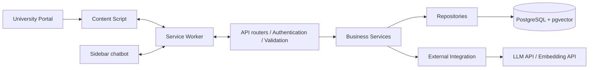

# Kiến trúc và ranh giới module

Nguồn: phần kiến trúc và yêu cầu từng module trong [tài liệu SOA](https://docs.google.com/document/d/1RdrPaiqRVWgo-E0XVKrm6I3uy3kMsrF4lWUEg6vdPHw/edit).

Backend Flask là một ứng dụng phân tầng, gồm sáu module nghiệp vụ. Mỗi module có API, service và repository liên quan để một thành viên có thể nhận trọn luồng. Các service hiện là file khung, chưa có xử lý nghiệp vụ.

Tầng dữ liệu đã có 18 model theo ERD, migration `0001_initial` và seed phát triển. Cần chạy migration trên PostgreSQL để tạo bảng. Các bảng phiên/consent và ràng buộc database chưa thay thế xác thực/phân quyền ở API; các route, repository, AI client và Extension vẫn cần triển khai.

## Các tầng theo tài liệu

| Tầng | Vị trí trong repo | Trách nhiệm |
| --- | --- | --- |
| External System | University Portal bên ngoài repo | Nguồn môn học, tài liệu, quiz đã chấm và điểm sinh viên được xem. |
| Client | `extension/src/sidebar/` | UI chatbot, hiển thị nguồn, mục tiêu điểm, sửa và sao chép comment. |
| Client | `extension/src/content/` | Kiểm tra URL Portal, đọc DOM sau cấp quyền; adapter và extractor tách riêng. |
| Client | `extension/src/background/` | Service Worker điều phối message, lưu cấu hình/quyền và gọi backend. |
| Gateway / API | `backend/src/student_assistant/api/` | Router, xác thực người dùng ứng dụng, kiểm tra quyền và đầu vào. |
| Business Logic | `backend/src/student_assistant/modules/<module>/service.py` | RAG/Chat, Document, Quiz Review, Grade Planning, Comment Suggestion, Learning Recommendation. |
| Data Access | `backend/src/student_assistant/modules/<module>/repository.py`, `models.py` | Đọc/ghi dữ liệu và mô hình SQLAlchemy. |
| External Integration | `backend/src/student_assistant/integrations/` | LLM/embedding client, API key, timeout, retry và lỗi provider. |
| Infrastructure | `infrastructure/`, `backend/migrations/` | PostgreSQL, pgvector và migration. LLM/Embedding API là dịch vụ ngoài. |

## Quy tắc phụ thuộc

- API nhận request, kiểm tra danh tính/quyền và dữ liệu rồi gọi service; không chứa prompt hay truy vấn SQL.
- Service điều phối nghiệp vụ, gọi repository và integration; không phụ thuộc Flask request/response.
- Repository giới hạn dữ liệu theo người dùng/môn học, không gọi LLM. Model không phụ thuộc API.
- Integration đóng gói provider; service không tự giữ API key hay tự viết HTTP client cho từng chức năng.
- UI gọi backend qua Service Worker; đọc Portal qua Content Script và chỉ sau consent.
- Comment dùng kết quả Quiz Review; Recommendation dùng dữ liệu quiz chi tiết và tài liệu. Thống nhất dữ liệu trao đổi trước khi ghép module.
- Recommendation sở hữu dữ liệu phân tích, bằng chứng, chủ đề và đề xuất; các bảng nối lưu cả tài liệu nguồn không xuất hiện trong citation. Comment và phép tính điểm không lưu kết quả riêng.
- Chunk dùng `vector` chưa cố định chiều. Service phải lọc cùng embedding model/chiều với truy vấn; chọn provider và D trước khi tạo ANN index bằng migration tiếp theo.

## Luồng chính

1. Sinh viên mở Sidebar và cấp quyền. Worker lưu trạng thái; Content Script chỉ đọc dữ liệu đã cho phép.
2. Worker gửi yêu cầu lên API. Backend xác thực người dùng, kiểm tra phạm vi dữ liệu và validate.
3. Service xử lý qua repository hoặc LLM/embedding integration; trả kết quả có nguồn và giới hạn dữ liệu để Sidebar hiển thị.
4. Với tài liệu: trích xuất → chia đoạn → embedding → lưu metadata/vector. Với RAG: embedding truy vấn → tìm đoạn theo quyền/môn → LLM → câu trả lời kèm nguồn.
5. Với điểm: dùng mục tiêu, thang điểm và trọng số thực tế để tính; LLM không thay phép tính.

Không lấy mật khẩu/token phiên Portal, không tự sửa điểm hoặc gửi comment. Thu hồi quyền phải chặn lần đọc tiếp theo và ngừng tác vụ phụ thuộc quyền đó. Xác thực, validation, consent enforcement và truy vấn theo quyền vẫn cần triển khai; cấu trúc thư mục chưa cung cấp các cơ chế này.

Xem [database và migration](database.md), [bảng chia việc](modules.md) và [ánh xạ use case](use-cases.md).
