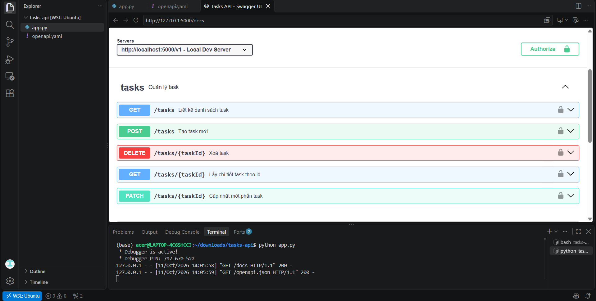

# Tasks API

Bài tập nhóm môn **API / Web Services**: Thiết kế và cài đặt RESTful API quản lý công việc (Task Management) đơn giản bằng **Python / Flask** và mô tả giao diện bằng **OpenAPI 3.0**.

---

## 💡 2 Quyết Định Thiết Kế Quan Trọng

### 1. Phân biệt rõ lỗi cú pháp (400) và lỗi dữ liệu (422) theo chuẩn RFC 7807

* **Vấn đề:** Khi client gửi dữ liệu không hợp lệ, việc dùng chung một mã lỗi `400 Bad Request` làm cho phía Frontend khó xác định nguyên nhân chính xác để hiển thị thông báo lỗi phù hợp cho người dùng.
* **Giải pháp:** Nhóm thống nhất phân tách rõ ràng thành 2 trường hợp:
  * **`400 Bad Request`**: Dùng cho các lỗi sai định dạng cú pháp cơ bản.
    * *Ví dụ:* Request body không đúng định dạng JSON, tham số `limit` trên URL không phải là số.
  * **`422 Unprocessable Entity`**: Dùng cho các lỗi vi phạm quy tắc kiểm tra dữ liệu (validation).
    * *Ví dụ:* Bỏ trống `title` khi tạo task, `title` vượt quá 200 ký tự, `dueDate` không đúng chuẩn `YYYY-MM-DD`, hoặc `assigneeId` không đúng định dạng UUID.
* **Kết quả:** Cấu trúc thông báo lỗi trả về tuân theo chuẩn **RFC 7807 (Problem Details)**, giúp ứng dụng Frontend dễ dàng đọc và xử lý thông tin lỗi chi tiết.

---

### 2. Sử dụng phân trang theo Offset (Offset-based Pagination)

* **Vấn đề:** Khi thiết kế endpoint lấy danh sách công việc (`GET /v1/tasks`), nhóm cần chọn giữa hai phương pháp phân trang: **Offset-based** (`limit`, `offset`) và **Cursor-based**. Mặc dù Cursor-based tối ưu hơn về hiệu năng với dữ liệu lớn và tránh trùng lặp khi danh sách biến động, nhưng lại phức tạp trong khâu xử lý và khó làm giao diện phân trang dạng số (`1, 2, 3...`).
* **Giải pháp:** Nhóm quyết định lựa chọn phương pháp **Offset-based** (`limit` và `offset`) vì:
  * Đơn giản, dễ cài đặt và đáp ứng tốt nhu cầu của ứng dụng quản lý task quy mô nhỏ.
  * Đặt giới hạn `limit` mặc định là **20** và tối đa là **100** để tránh việc truy vấn quá nhiều dữ liệu cùng lúc làm ảnh hưởng tới hiệu năng server.
* **Kết quả:** Phía Frontend tích hợp giao diện chuyển trang đơn giản và server hoạt động ổn định, mượt mà.